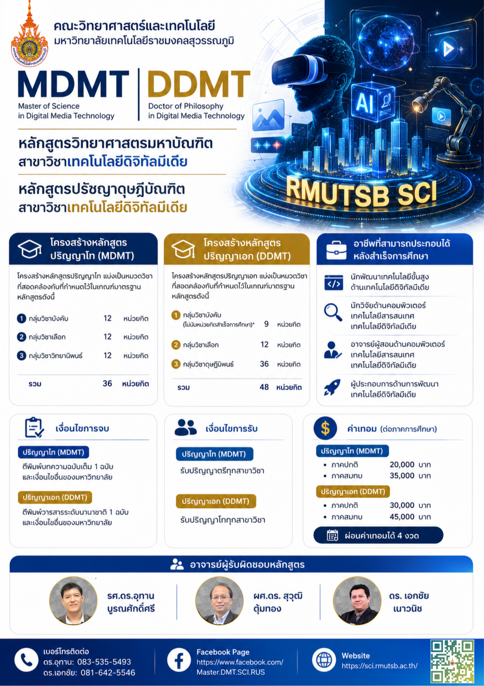

<p>
  <a href="https://www.aihero.dev/s/skills-newsletter">
    <picture>
      <source media="(prefers-color-scheme: dark)" srcset="https://res.cloudinary.com/total-typescript/image/upload/v1777382277/skills-repo-dark_2x.png">
      <source media="(prefers-color-scheme: light)" srcset="https://res.cloudinary.com/total-typescript/image/upload/v1777382277/skill-repo-light_2x.png">
      
    </picture>
  </a>
</p>

# Skills For Real Engineers

[](https://skills.sh/utarn/engineer-skills)

Agent skills that Utharn Buranasaksee uses every day to do real engineering - not vibe coding.

Developing real applications is hard. Approaches like GSD, BMAD, and Spec-Kit try to help by owning the process. But while doing so, they take away your control and make bugs in the process hard to resolve.

These skills are designed to be small, easy to adapt, and composable. They work with any model. They're based on decades of engineering experience. Hack around with them. Make them your own. Enjoy.



If you want to keep up with changes to these skills, and any new ones I create, you can join ~60,000 other devs on my newsletter:

[Sign Up To The Newsletter](https://www.aihero.dev/s/skills-newsletter)

## Installation (30-second setup)

A plugin updates itself. [skills.sh](https://skills.sh/utarn/engineer-skills) copies editable files into your project, and you update them by hand. Pick one per agent, because installing both gives you every skill twice.

### 1. Get the skills

<details>
<summary><strong>Claude Code</strong></summary>

```bash
claude plugin marketplace add utarn/engineer-skills
claude plugin install utarn-skills@utarn
```

Updates itself when the plugin `version` changes.

</details>

<details>
<summary><strong>Codex</strong></summary>

```bash
codex plugin marketplace add utarn/engineer-skills
codex plugin add utarn-skills@utarn
```

Updates itself at startup.

</details>

<details>
<summary><strong>GitHub Copilot</strong> (CLI and VS Code)</summary>

```bash
copilot plugin marketplace add utarn/engineer-skills
copilot plugin install utarn-skills@utarn
```

Then, once, add to `~/.copilot/settings.json`:

```json
{
  "extraKnownMarketplaces": {
    "utarn": { "source": { "source": "github", "repo": "utarn/engineer-skills" }, "autoUpdate": true }
  }
}
```

In VS Code, run **Chat: Install Plugin From Source** and enter `https://github.com/utarn/engineer-skills`. It updates daily.

</details>

<details>
<summary><strong>Gemini CLI</strong> (manual updates)</summary>

```bash
gemini skills install https://github.com/utarn/engineer-skills.git --path skills/engineering
gemini skills install https://github.com/utarn/engineer-skills.git --path skills/productivity
```

Re-run both commands to update.

</details>

<details>
<summary><strong>Any other agent, or editable files</strong> (manual updates)</summary>

```bash
npx skills@latest add utarn/engineer-skills -a <agent>  # cursor, opencode, devin, windsurf, amp, pi; omit -a to choose
```

When the installer asks which skills to take, include `setup-utarn-skills`. To update, run `npx skills@latest update`, and re-run `add` to pick up new skills.

</details>

### 2. Run `/setup-utarn-skills`

In your agent, run it once per repo. It will:

- Ask you which issue tracker you want to use (GitHub, GitLab, local files, or anything else you describe)
- Ask you what labels you apply to tickets when you triage them (`/triage` uses labels)
- Ask you where you want to save any docs we create

### 3. Bam - you're ready to go.

## วิธีติดตั้ง (ภาษาไทย)

ติดตั้งสกิลทั้งหมดแบบ global:

```bash
npx skills@latest add utarn/engineer-skills -g
```

จากนั้นรันอัปเดต:

```bash
npx skills update -g -y
```

คำอธิบายคำสั่ง:
- **`npx skills add utarn/engineer-skills -g`** — ดาวน์โหลดสกิลทั้งหมดจาก repo นี้ไปไว้ในเครื่องแบบ global (`-g` = global) คำสั่งนี้ต้องใช้ครั้งเดียว
- **`npx skills update -g -y`** — อัปเดตสกิลทั้งหมดในเครื่องให้เป็นเวอร์ชันล่าสุด (`-y` = ยืนยันอัตโนมัติโดยไม่ต้องถาม) ใช้คำสั่งนี้เมื่อต้องการซิงค์สกิลเวอร์ชันใหม่

## Why These Skills Exist

I built these skills as a way to fix common failure modes I see with Claude Code, Codex, and other coding agents.

### #1: The Agent Didn't Do What I Want

> "No-one knows exactly what they want"
>
> David Thomas & Andrew Hunt, [The Pragmatic Programmer](https://www.amazon.co.uk/Pragmatic-Programmer-Anniversary-Journey-Mastery/dp/B0833F1T3V)

**The Problem**. The most common failure mode in software development is misalignment. You think the dev knows what you want. Then you see what they've built - and you realize it didn't understand you at all.

This is just the same in the AI age. There is a communication gap between you and the agent. The fix for this is a **grilling session** - getting the agent to ask you detailed questions about what you're building.

**The Fix** is to use:

- [`/grill-me`](./skills/productivity/grill-me/SKILL.md) - for non-code uses
- [`/grill-with-docs`](./skills/engineering/grill-with-docs/SKILL.md) - same as [`/grill-me`](./skills/productivity/grill-me/SKILL.md), but adds more goodies (see below)
- [`/grill-novice`](./skills/engineering/grill-novice/SKILL.md) - same as [`/grill-with-docs`](./skills/engineering/grill-with-docs/SKILL.md), but the agent settles the technical details itself and you only answer the functional requirements, in plain simplified English

These are my most popular skills. They help you align with the agent before you get started, and think deeply about the change you're making. Use them _every_ time you want to make a change.

### #2: The Agent Is Way Too Verbose

> With a ubiquitous language, conversations among developers and expressions of the code are all derived from the same domain model.
>
> Eric Evans, [Domain-Driven-Design](https://www.amazon.co.uk/Domain-Driven-Design-Tackling-Complexity-Software/dp/0321125215)

**The Problem**: At the start of a project, devs and the people they're building the software for (the domain experts) are usually speaking different languages.

I felt the same tension with my agents. Agents are usually dropped into a project and asked to figure out the jargon as they go. So they use 20 words where 1 will do.

**The Fix** for this is a shared language. It's a document that helps agents decode the jargon used in the project.

<details>
<summary>
Example
</summary>

Here's an example [glossary](https://github.com/mattpocock/course-video-manager/blob/076a5a7a182db0fe1e62971dd7a68bcadf010f1c/CONTEXT.md) (still named `CONTEXT.md` at that pinned commit, from before the skills renamed the convention), from my `course-video-manager` repo. Which one is easier to read?

- **BEFORE**: "There's a problem when a lesson inside a section of a course is made 'real' (i.e. given a spot in the file system)"
- **AFTER**: "There's a problem with the materialization cascade"

This concision pays off session after session.

</details>

This is built into [`/grill-with-docs`](./skills/engineering/grill-with-docs/SKILL.md). It's a grilling session, but that helps you build a shared language with the AI, and document hard-to-explain decisions in ADR's.

It's hard to explain how powerful this is. It might be the single coolest technique in this repo. Try it, and see.

> [!TIP]
> A shared language has many other benefits than reducing verbosity:
>
> - **Variables, functions and files are named consistently**, using the shared language
> - As a result, the **codebase is easier to navigate** for the agent
> - The agent also **spends fewer tokens on thinking**, because it has access to a more concise language

### #3: The Code Doesn't Work

> "Always take small, deliberate steps. The rate of feedback is your speed limit. Never take on a task that’s too big."
>
> David Thomas & Andrew Hunt, [The Pragmatic Programmer](https://www.amazon.co.uk/Pragmatic-Programmer-Anniversary-Journey-Mastery/dp/B0833F1T3V)

**The Problem**: Let's say that you and the agent are aligned on what to build. What happens when the agent _still_ produces crap?

It's time to look at your feedback loops. Without feedback on how the code it produces actually runs, the agent will be flying blind.

**The Fix**: You need the usual tranche of feedback loops: static types, browser access, and automated tests.

For automated tests, a red-green-refactor loop is critical. This is where the agent writes a failing test first, then fixes the test. This helps give the agent a consistent level of feedback that results in far better code.

I've built a **[`/tdd`](./skills/engineering/tdd/SKILL.md) skill** you can slot into any project. It encourages red-green-refactor and gives the agent plenty of guidance on what makes good and bad tests.

For debugging, I've also built a **[`/diagnosing-bugs`](./skills/engineering/diagnosing-bugs/SKILL.md)** skill that wraps best debugging practices into a disciplined loop, gated phase by phase.

### #4: We Built A Ball Of Mud

> "Invest in the design of the system _every day_."
>
> Kent Beck, [Extreme Programming Explained](https://www.amazon.co.uk/Extreme-Programming-Explained-Embrace-Change/dp/0321278658)

> "The best modules are deep. They allow a lot of functionality to be accessed through a simple interface."
>
> John Ousterhout, [A Philosophy Of Software Design](https://www.amazon.co.uk/Philosophy-Software-Design-2nd/dp/173210221X)

**The Problem**: Most apps built with agents are complex and hard to change. Because agents can radically speed up coding, they also accelerate software entropy. Codebases get more complex at an unprecedented rate.

**The Fix** for this is a radical new approach to AI-powered development: caring about the design of the code.

This is built in to every layer of these skills:

- [`/to-spec`](./skills/engineering/to-spec/SKILL.md) quizzes you about which modules you're touching before creating a spec

And crucially, [`/improve-codebase-architecture`](./skills/engineering/improve-codebase-architecture/SKILL.md) surveys a codebase for deepening opportunities and hands you the candidates. I recommend running it on your codebase once every few days. It is a survey, not a rescue: on a genuinely old codebase it will find real candidates, but it won't untangle the mud for you.

### Summary

Software engineering fundamentals matter more than ever. These skills are my best effort at condensing these fundamentals into repeatable practices, to help you ship the best apps of your career. Enjoy.

## Reference

These split on one axis: who can invoke them. **User-invoked** skills are reachable only when you type them (e.g. `/grill-me`); their job is to orchestrate. **Model-invoked** skills can be invoked by you _or_ reached for automatically by the agent when the task fits; they hold the reusable discipline. A user-invoked skill may invoke model-invoked skills, but never another user-invoked one.

### Engineering

Skills I use daily for code work.

**User-invoked**

- **[ask-utarn](./skills/engineering/ask-utarn/SKILL.md)**: Ask which skill or flow fits your situation. A router over the user-invoked skills in this repo.
- **[grill-with-docs](./skills/engineering/grill-with-docs/SKILL.md)**: Grilling session that also builds your project's domain model, sharpening terminology and updating `GLOSSARY.md` and ADRs inline.
- **[grill-novice](./skills/engineering/grill-novice/SKILL.md)**: Grilling session that asks you only the functional requirements, in plain simplified English, while the agent settles every technical detail itself and recaps the assumptions for your veto before anything is written.
- **[triage](./skills/engineering/triage/SKILL.md)**: Move issues through a state machine of triage roles.
- **[bug-tracker](./skills/engineering/bug-tracker/SKILL.md)**: Work the actionable queue of a public GitHub bug tracker one issue at a time: investigate and verify, tag, solve via subagents, comment, mark resolved, and close.
- **[init-bug-tracker](./skills/engineering/init-bug-tracker/SKILL.md)**: Initialize or re-sync a bug tracker's label taxonomy (states, types, priorities, verification, derived `area:` labels) and issue forms, and record the tracker for the other skills. Run once per tracker repo.
- **[improve-codebase-architecture](./skills/engineering/improve-codebase-architecture/SKILL.md)**: Scan a codebase for deepening opportunities, present them as a visual HTML report, then grill through whichever one you pick.
- **[setup-utarn-skills](./skills/engineering/setup-utarn-skills/SKILL.md)**: Configure this repo for the engineering skills (issue tracker, triage labels, domain doc layout). Run once per repo before using the other engineering skills.
- **[setup-utarn-skills-yes](./skills/engineering/setup-utarn-skills-yes/SKILL.md)**: Like `/setup-utarn-skills`, but accepts every recommended default for the repo (tracker from the remote, default triage labels, matching doc layout) and writes the configuration without a confirmation round.
- **[to-issues](./skills/engineering/to-issues/SKILL.md)**: Break any plan, spec, or PRD into independently-grabbable issues using vertical slices.
- **[to-issues-yes](./skills/engineering/to-issues-yes/SKILL.md)**: Like `/to-issues`, but assumes you approve the breakdown and publishes the tracer-bullet issues straight to the tracker without an approval round.
- **[to-prd](./skills/engineering/to-prd/SKILL.md)**: Turn the current conversation into a PRD and publish it to the issue tracker. No interview, just synthesizes what you've already discussed.
- **[to-spec](./skills/engineering/to-spec/SKILL.md)**: Turn the current conversation into a spec and publish it to the issue tracker. No interview, just synthesizes what you've already discussed.
- **[to-spec-yes](./skills/engineering/to-spec-yes/SKILL.md)**: Like `/to-spec`, but assumes you approve the proposed seams and publishes the spec straight to the tracker without a seam check.
- **[to-tickets](./skills/engineering/to-tickets/SKILL.md)**: Break any plan, spec, or conversation into a set of tracer-bullet tickets, each declaring its blocking edges, written as text in a local file, or as native blocking links on a real tracker.
- **[to-tickets-yes](./skills/engineering/to-tickets-yes/SKILL.md)**: Like `/to-tickets`, but assumes you approve the breakdown and publishes the tracer-bullet tickets straight to the configured tracker without an approval round.
- **[implement](./skills/engineering/implement/SKILL.md)**: Build the work described by a spec or set of tickets, driving `/tdd` at pre-agreed seams and closing out with `/code-review` before committing.
- **[implement-spec](./skills/engineering/implement-spec/SKILL.md)**: Implement a whole spec on one integration branch. Works the tickets as a task graph, running implementer subagents across the ready frontier for maximum concurrency, then closes out with `/code-review`.
- **[wayfinder](./skills/engineering/wayfinder/SKILL.md)**: Plan a huge chunk of work, more than one agent session can hold, as a shared map of decision tickets on the issue tracker, and resolve them one at a time until the way to the destination is clear.
- **[retro](./skills/engineering/retro/SKILL.md)**: Suggest improvements to the coding agent's environment (navigation, automated checks, coding standards, steering files, tooling) after a session, most severe first.

**Model-invoked**

- **[prototype](./skills/engineering/prototype/SKILL.md)**: Build a throwaway prototype to answer a design question, either a single shareable HTML file for state/logic questions, or several radically different UI variations toggleable from one route.
- **[diagnosing-bugs](./skills/engineering/diagnosing-bugs/SKILL.md)**: Disciplined diagnosis loop for hard bugs and performance regressions: build a feedback loop that goes red on this bug → minimise → hypothesise → instrument → fix → regression-test.
- **[research](./skills/engineering/research/SKILL.md)**: Investigate a question against high-trust primary sources and capture the findings as a cited Markdown file in the repo, run as a background agent.
- **[tdd](./skills/engineering/tdd/SKILL.md)**: Test-driven development with a red-green-refactor loop. Builds features or fixes bugs one vertical slice at a time.
- **[domain-modeling](./skills/engineering/domain-modeling/SKILL.md)**: Actively build and sharpen a project's domain model: challenge terms against the glossary, stress-test with edge-case scenarios, and update `GLOSSARY.md` and ADRs inline.
- **[codebase-design](./skills/engineering/codebase-design/SKILL.md)**: Shared discipline and vocabulary for designing deep modules: a lot of behaviour behind a small interface, placed at a clean seam, testable through that interface.
- **[find-mismatch](./skills/engineering/find-mismatch/SKILL.md)**: Systematic code review focusing on bugs that break at runtime and JS/TS static analysis via fallow.
- **[code-review](./skills/engineering/code-review/SKILL.md)**: Two-axis review of the diff since a fixed point: **Standards** (does it follow the repo's coding standards, plus a Fowler smell baseline?) and **Spec** (does it faithfully implement the originating issue/spec?), run as parallel sub-agents so neither pollutes the other.
- **[pr](./skills/engineering/pr/SKILL.md)**: The shape a pull request body should take: a summary as the smallest visual that makes the change clear, before/after evidence that it works, and a merge-danger call (one-way or two-way door, plus blast radius).
- **[work-on-issues](./skills/engineering/work-on-issues/SKILL.md)**: Fetch, implement, and close GitHub/GitLab issues sequentially (one main issue starting with PRD:/feat: at a time).

### Productivity

General workflow tools, not code-specific.

**User-invoked**

- **[grill-me](./skills/productivity/grill-me/SKILL.md)**: Get relentlessly interviewed about a plan or design until every branch of the design tree is resolved.
- **[handoff](./skills/productivity/handoff/SKILL.md)**: Compact the current conversation into a handoff document so another agent can continue the work.
- **[teach](./skills/productivity/teach/SKILL.md)**: Teach the user a new skill or concept over multiple sessions, using the current directory as a stateful teaching workspace.
- **[to-questionnaire](./skills/productivity/to-questionnaire/SKILL.md)**: Turn a decision you can't answer alone into a Markdown questionnaire for the one person who can, filled in async, or together over a meeting. It grills you about the send (who it's for, what you need back), not the subject.
- **[wait-what](./skills/productivity/wait-what/SKILL.md)**: Fire this the moment a message doesn't land. The agent re-pitches it with the context you're missing, in plain English, using your `GLOSSARY.md` vocabulary.

**Model-invoked**

- **[grilling](./skills/productivity/grilling/SKILL.md)**: Interview the user relentlessly about a plan, decision, or idea until every branch of the decision tree is resolved. The reusable loop behind `grill-me` and `grill-with-docs`.
- **[writing-for-agents](./skills/productivity/writing-for-agents/SKILL.md)**: Writing documents for agents: skills, AGENTS.md/CLAUDE.md, and any doc an agent reaches by a pointer.

## Install Claude Code Plugins

To install the bundled Claude Code plugins, run the corresponding command for your platform.

**Unix / macOS:**

```bash
mkdir -p ~/.claude && cp -R /tmp/skills/engineer-skills-main/skills/* ~/.claude/plugins/ && \
echo "Plugins installed"
```

**Windows PowerShell:**

```powershell
New-Item -ItemType Directory -Force -Path "$env:USERPROFILE\.claude\plugins"
Copy-Item -Recurse -Force $env:TEMP\engineer-skills-main\skills\* "$env:USERPROFILE\.claude\plugins\"
```

### Plugin list

The following plugins are included (all marked `true` for `claude-plugins-official`):

| Plugin ID |
|---|
| `pyright-lsp@claude-plugins-official` |
| `clangd-lsp@claude-plugins-official` |
| `rust-analyzer-lsp@claude-plugins-official` |
| `gopls-lsp@claude-plugins-official` |
| `context7@claude-plugins-official` |
| `frontend-design@claude-plugins-official` |
| `superpowers@claude-plugins-official` |
| `playwright@claude-plugins-official` |
| `brightdata-plugin@claude-plugins-official` |
| `typescript-lsp@claude-plugins-official` |
| `jdtls-lsp@claude-plugins-official` |
| `php-lsp@claude-plugins-official` |
| `kotlin-lsp@claude-plugins-official` |
| `swift-lsp@claude-plugins-official` |
| `lua-lsp@claude-plugins-official` |
| `ruby-lsp@claude-plugins-official` |
| `liquid-lsp@claude-plugins-official` |
| `code-review@claude-plugins-official` |
| `skill-creator@claude-plugins-official` |
| `github@claude-plugins-official` |
| `claude-md-management@claude-plugins-official` |
| `csharp-lsp@claude-plugins-official` |
| `code-simplifier@claude-plugins-official` |
| `feature-dev@claude-plugins-official` |
| `security-guidance@claude-plugins-official` |

The following plugins are included:

| Plugin | Purpose |
|---|---|
| `pyright-lsp` | Python language server |
| `clangd-lsp` | C/C++ language server |
| `rust-analyzer-lsp` | Rust language server |
| `gopls-lsp` | Go language server |
| `context7` | Documentation lookup |
| `frontend-design` | Frontend UI design |
| `superpowers` | Superpowers AI assistant |
| `playwright` | Browser automation |
| `brightdata-plugin` | Web scraping |
| `typescript-lsp` | TypeScript language server |
| `jdtls-lsp` | Java language server |
| `php-lsp` | PHP language server |
| `kotlin-lsp` | Kotlin language server |
| `swift-lsp` | Swift language server |
| `lua-lsp` | Lua language server |
| `ruby-lsp` | Ruby language server |
| `liquid-lsp` | Liquid language server |
| `code-review` | Code review assistance |
| `skill-creator` | Create new skills |
| `github` | GitHub integration |
| `claude-md-management` | Markdown management |
| `csharp-lsp` | C# language server |
| `code-simplifier` | Code simplification |
| `feature-dev` | Feature development |
| `security-guidance` | Security guidance |

---

This project is forked from https://github.com/mattpocock/skills
